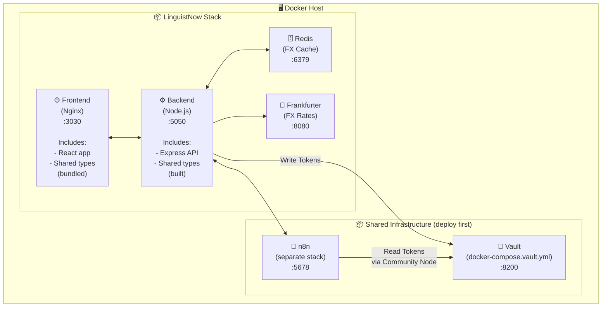
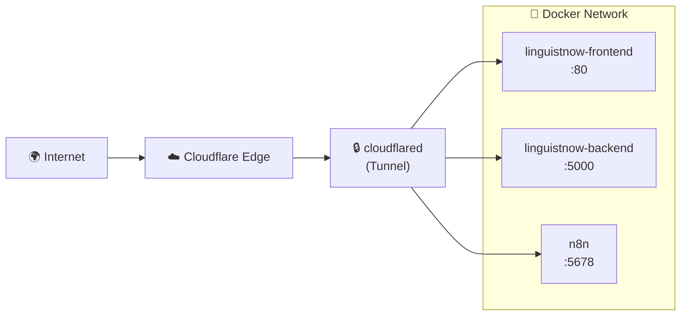

# Deploy LinguistNow to Production

This guide covers deploying LinguistNow to production using **Docker and Docker Compose**. It is tool-agnostic and works seamlessly with container management tools like **Dockhand**, **Dockge**, or **Portainer**, as well as the standard Docker Compose CLI. While examples reference Synology NAS, the steps apply to any Docker host.

The LinguistNow stack includes:

- **Frontend**: React application served by Nginx
- **Backend**: Node.js Express API server
- **Redis**: In-memory cache for FX rates & sessions
- **Frankfurter**: Self-hosted European Central Bank FX rates service
- **Shared Package**: TypeScript library (built and bundled into frontend/backend, not a separate container)

## Prerequisites

Before deploying LinguistNow, ensure the following are set up:

1. **Docker host** (Synology NAS, Linux server, cloud VM, etc.)
2. **Docker** and **Docker Compose** installed
3. **Container Manager** (Dockhand, Dockge, Portainer, or CLI access)
4. **Shared Docker Network**: `shared_net` created (`docker network create shared_net`)
5. **Google OAuth credentials** configured (see [Google Authentication Setup](../integrations/google-authentication.md#setup-google-oauth-configuration))
6. **Airtable database** set up (see [Install Instructions](../getting-started/install-instructions.md#airtable-database))

### Shared Infrastructure (Deploy First)

LinguistNow requires these shared services to be running:

| Service             | Purpose                        | Deployment Guide                                                                                                                                                                            |
| ------------------- | ------------------------------ | ------------------------------------------------------------------------------------------------------------------------------------------------------------------------------------------- |
| **HashiCorp Vault** | Secure OAuth token storage     | [Vault Integration Guide](../integrations/vault-integration-guide.md#deploy-vault) (deploy), then [Production Mode](../integrations/vault-integration-guide.md#production-mode) (configure) |
| **n8n**             | Calendar availability workflow | [n8n Workflow Integration](../integrations/n8n-workflow-integration.md#3-deploy-n8n)                                                                                                        |

---

## Table of Contents

- [Architecture Overview](#architecture-overview)
- [Step 1: Configure GitHub Repository Secrets (For CI/CD)](#step-1-configure-github-repository-secrets-for-cicd) _(optional)_
- [Step 2: Update Google OAuth Configuration](#step-2-update-google-oauth-configuration)
- [Step 3: Setup Container Management (Dockhand, Dockge, or Portainer)](#step-3-setup-container-management-dockhand-dockge-or-portainer)
- [Step 4: Deploy LinguistNow Stack](#step-4-deploy-linguistnow-stack)
- [Step 5: Verify Deployment](#step-5-verify-deployment)
- [Step 6: Configure External Access](#step-6-configure-external-access-choose-one)
- [Troubleshooting](#troubleshooting)
- [Maintenance](#maintenance)
- [Security Recommendations](#security-recommendations)
- [Appendix: Local Development with Docker](#appendix-local-development-with-docker)

---

## Architecture Overview



**Note**: The `@linguistnow/shared` package is a TypeScript library containing shared types and utilities. It is:

- **Built during the Docker build process** (compiled to JavaScript)
- **Bundled into the frontend** static files by Vite
- **Included in the backend** container as a dependency
- **Not a separate service** - no container needed, just a build-time dependency

---

## Step 1: Configure GitHub Repository Secrets (For CI/CD)

If you fork this repository and want the GitHub Actions workflow to build Docker images with your production URLs, configure these repository secrets:

1. Go to your GitHub repository → **Settings** → **Secrets and variables** → **Actions**

2. Click **New repository secret** and add:

   | Secret Name             | Description                 | Example                            |
   | ----------------------- | --------------------------- | ---------------------------------- |
   | `VITE_API_URL`          | Your backend API public URL | `https://api.yourdomain.com`       |
   | `VITE_BASE_URL`         | Your frontend public URL    | `https://app.yourdomain.com`       |
   | `VITE_GOOGLE_CLIENT_ID` | Google OAuth client ID      | `123...apps.googleusercontent.com` |

3. After adding secrets, push to `main` or manually trigger the workflow

4. The published Docker images will have your production URLs baked in

> **Note**: Without these secrets, images are built with `localhost` URLs (suitable for local testing only).

---

## Step 2: Update Google OAuth Configuration

Before deploying, update your Google OAuth settings to use your production URLs.

1. Go to [Google Cloud Console - Credentials](https://console.cloud.google.com/apis/credentials)

2. Edit your OAuth 2.0 Client ID

3. Add your production URLs to **Authorized JavaScript origins**:

   ```
   https://linguistnow.yourdomain.com
   http://your-docker-host:3030
   ```

4. Add your production URLs to **Authorized redirect URIs**:

   ```
   https://linguistnow.yourdomain.com
   http://your-docker-host:3030
   ```

5. Click **Save**

> **Note**: If using a reverse proxy with HTTPS, use the HTTPS URLs. The redirect URI must exactly match the `FRONTEND_URL` / `VITE_BASE_URL` in your environment configuration.

---

## Step 3: Setup Container Management (Dockhand, Dockge, or Portainer)

LinguistNow is fully compliant with the standard **Docker Compose specification**. You can manage it with any container management tool:

- **Dockhand / Dockge**: Lightweight Docker Compose managers that track native compose files and `.env` directly.
- **Portainer**: Full container management UI (go to **Stacks** → **Add Stack**).
- **Docker Compose CLI**: Standard command line (`docker compose`) via SSH.

### Create Shared Network

Ensure the shared Docker network exists on your host so LinguistNow can communicate with Vault and other shared services:

```bash
docker network inspect shared_net >/dev/null 2>&1 || docker network create shared_net
```

---

## Step 4: Deploy LinguistNow Stack

LinguistNow uses a single unified **`docker-compose.yml`** file for all deployments.

### Method A: Deploy via Docker Management UI (Dockhand, Dockge, Portainer)

1. **Ensure shared infrastructure is running:**
   - Vault: Deploy via [Vault Integration Guide](../integrations/vault-integration-guide.md#deploy-vault), then configure for [Production Mode](../integrations/vault-integration-guide.md#production-mode)
   - n8n: See [n8n Workflow Integration - Deploy n8n](../integrations/n8n-workflow-integration.md#3-deploy-n8n)

2. Create a new stack in your management UI:
   - **Repository URL**: `https://github.com/nicmart-dev/linguistnow`
   - **Compose path**: `docker-compose.yml`
   - **Stack name**: `linguistnow`

3. Add **environment variables**:

   ```env
   # Required Configuration
   FRONTEND_URL=https://linguistnow.yourdomain.com
   BACKEND_URL=https://api.yourdomain.com
   GOOGLE_CLIENT_ID=your_google_client_id
   GOOGLE_CLIENT_SECRET=your_google_client_secret
   AIRTABLE_PERSONAL_ACCESS_TOKEN=pat_xxxxx
   AIRTABLE_BASE_ID=appxxxxx

   # Vault Integration (from Vault setup)
   VAULT_ADDR=http://shared-vault:8200
   VAULT_TOKEN=<token-from-vault-setup>
   VAULT_SECRET_PATH=secret/data/linguistnow/tokens

   # FX Rates Services (Defaults shown)
   REDIS_URL=redis://redis:6379
   FRANKFURTER_URL=http://frankfurter:8080
   FRANKFURTER_FALLBACK_URL=https://api.frankfurter.dev/v1

   # Security & Internal APIs (Recommended)
   INTERNAL_API_KEY=<strong-random-api-key>
   SESSION_SECRET=<32-char-random-secret-for-persistent-sessions>
   TRUST_PROXY=1 # Set if behind reverse proxy (Caddy, Nginx, Traefik, etc.)

   # Networking
   DOCKER_NETWORK_NAME=shared_net
   USE_EXTERNAL_NETWORK=true
   ```

4. Deploy the stack. By default, your Docker tool will pull and run the pre-built images from GitHub Container Registry (`ghcr.io/nicmart-dev/linguistnow-...:latest`).

---

### Method B: Deploy via Docker Compose CLI (SSH)

SSH into your Docker host and run:

```bash
# Navigate to the project directory
cd /volume1/docker/linguistnow

# Clone the repository (first time only)
git clone https://github.com/nicmart-dev/linguistnow.git .

# Copy and configure environment
cp example.env .env
nano .env  # Edit with your values

# Option 1: Pull pre-built images and deploy (recommended)
docker compose pull && docker compose up -d

# Option 2: Build images from local source
docker compose up -d --build
```

---

## Step 5: Verify Deployment

### Check Container Health

In your container manager (Dockhand, Dockge, Portainer) or via `docker compose ps`, verify all containers show as **healthy**:

- `linguistnow-backend` - Should show healthy after ~10 seconds
- `linguistnow-frontend` - Should show healthy after ~5 seconds

### Test the Application

1. **Frontend**: Open `http://your-docker-host:3030` in a browser
2. **Backend API**: Visit `http://your-docker-host:5050/api/health`

### Test OAuth Flow

1. Click **Sign in with Google** on the frontend
2. Complete the Google authentication
3. Verify you're redirected back and logged in
4. Check Vault for stored tokens (see [Vault Integration Guide](../integrations/vault-integration-guide.md#troubleshooting))

---

## Step 6: Configure External Access (Choose One)

To access your deployment from the internet with HTTPS, choose one of these options:

### Option A: Cloudflare Tunnel (Recommended)

[Cloudflare Tunnel](https://developers.cloudflare.com/cloudflare-one/connections/connect-networks/) provides secure external access without exposing ports or managing SSL certificates.

**Architecture:**



**Setup:**

1. Create a Cloudflare Tunnel in [Zero Trust Dashboard](https://one.dash.cloudflare.com/)

2. Run `cloudflared` as a Docker container on the same network as your app

3. Configure public hostnames pointing to container names:

   | Public Hostname      | Service URL                       |
   | -------------------- | --------------------------------- |
   | `app.yourdomain.com` | `http://linguistnow-frontend:80`  |
   | `api.yourdomain.com` | `http://linguistnow-backend:5000` |
   | `n8n.yourdomain.com` | `http://n8n:5678`                 |

4. **Important**: Rebuild the frontend with your public URLs:

   ```bash
   VITE_API_URL=https://api.yourdomain.com
   VITE_BASE_URL=https://app.yourdomain.com
   ```

5. Update Google OAuth authorized redirect URIs to match your public frontend URL

**Benefits:**

- No port forwarding required
- Automatic SSL certificates
- DDoS protection
- Works behind CGNAT or restricted networks

### Option B: Synology's Built-in Reverse Proxy

1. Go to **Control Panel** → **Login Portal** → **Advanced** → **Reverse Proxy**

2. Create rules for each service:

   | Description          | Source                           | Destination             |
   | -------------------- | -------------------------------- | ----------------------- |
   | LinguistNow Frontend | `https://app.yourdomain.com:443` | `http://localhost:3030` |
   | LinguistNow API      | `https://api.yourdomain.com:443` | `http://localhost:5050` |
   | n8n                  | `https://n8n.yourdomain.com:443` | `http://localhost:5678` |

3. Enable **HSTS** for added security

4. Configure SSL certificates (Let's Encrypt or your own)

5. Set up port forwarding on your router (ports 80 and 443)

---

## Troubleshooting

### Container Won't Start

Check logs in your container manager or via CLI:

```bash
docker compose logs -f backend
docker compose logs -f frontend
```

### OAuth Redirect Error

- Verify `GOOGLE_REDIRECT_URI` matches exactly what's in Google Console
- Ensure `FRONTEND_URL` and `VITE_BASE_URL` are identical
- Check that the URL is listed in Google Console's Authorized redirect URIs

### Vault Token / Storage Issues

- Verify `VAULT_ADDR` and `VAULT_TOKEN` are set properly
- Ensure Vault is unsealed (in production mode: `docker exec -it shared-vault vault status`)
- Test connectivity from backend: `wget -qO- http://shared-vault:8200/v1/sys/health`

### Health Check Failures

- Backend: Ensure port 5050 is accessible and `/api/health` returns 200
- Frontend: Ensure Nginx is running and `/health` returns 200

### Connection Refused Between Services

- Verify all containers are on the same Docker network (`shared_net`)
- Use Docker service names (e.g., `http://shared-vault:8200`) for internal communication
- Use external URLs for browser-accessible endpoints

---

## Maintenance

### Updating the Application

```bash
# Pull latest code
git pull origin main

# Install dependencies (if running locally)
pnpm install

# Rebuild and restart containers
docker-compose up -d --build
```

Or in Portainer, click **Pull and redeploy** on the stack.

### Viewing Logs

```bash
# All services
docker-compose logs -f

# Specific service
docker-compose logs -f backend
```

---

## Security Recommendations

1. **Enable HTTPS** via reverse proxy with valid SSL certificates
2. **Enable n8n basic auth** in production:
   ```bash
   N8N_BASIC_AUTH_ACTIVE=true
   N8N_BASIC_AUTH_USER=admin
   N8N_BASIC_AUTH_PASSWORD=strong_password_here
   ```
3. **Restrict external access** to n8n and Vault if only used internally
4. **Regular updates**: Keep Docker images and host OS updated
5. **Firewall rules**: Only expose necessary ports (3030, 5050)

---

## Appendix: Local Development with Docker

> **Note**: This section is for local testing and development. For production deployment, follow the main guide above.

### Quick Start

For local testing, the core services (Frontend, Backend, Redis, Frankfurter) can be built from source, and optional dev services (n8n, Vault) can be enabled using the `dev` profile:

```bash
# Clone and setup
git clone https://github.com/nicmart-dev/linguistnow.git
cd linguistnow
cp example.env .env
cp server/example.env server/.env
cp client/example.env client/.env

# Option 1: Core stack (build from source)
docker compose up -d --build

# Option 2: Full local stack with mock Vault and n8n
docker compose --profile dev up -d --build

# View logs
docker compose logs -f
```

Access at:

- **Frontend**: http://localhost:3030
- **Backend API**: http://localhost:5050
- **Redis**: localhost:6379
- **Frankfurter**: http://localhost:8080
- **n8n** _(with `--profile dev`)_: http://localhost:5678
- **Vault** _(with `--profile dev`)_: http://localhost:8200

### Docker Compose Files

| File                                  | Purpose                                                                                   |
| ------------------------------------- | ----------------------------------------------------------------------------------------- |
| `docker-compose.yml`                  | Unified stack definition (uses pre-built GHCR images for production, `--build` for local) |
| `docker-compose.vault.yml`            | Dedicated shared HashiCorp Vault stack                                                    |
| `docker-compose.override.yml.example` | Template for optional local overrides (ports, bridge network, bind mounts)                |

**Note**: The `@linguistnow/shared` package is not a separate service. It's a library dependency that:

- Gets built during the Docker build process
- Is bundled into the frontend static files
- Is included in the backend container
- Does not require its own container or service definition

### Environment Variables

For local development, configure environment variables in `.env` files. Required variables include:

- `FRONTEND_URL`, `BACKEND_URL`, `GOOGLE_CLIENT_ID`, `GOOGLE_CLIENT_SECRET`
- `AIRTABLE_PERSONAL_ACCESS_TOKEN`, `AIRTABLE_BASE_ID`
- `VAULT_ADDR`, `VAULT_TOKEN`, `REDIS_URL`, `FRANKFURTER_URL`
- `VITE_API_URL`, `VITE_BASE_URL`, `VITE_GOOGLE_CLIENT_ID` (build-time)

**Key difference**: `docker-compose.yml` builds from source, so `VITE_*` variables are used at build time. See [Step 1: Configure GitHub Repository Secrets](#step-1-configure-github-repository-secrets-for-cicd) for details on Vite build-time variables.
